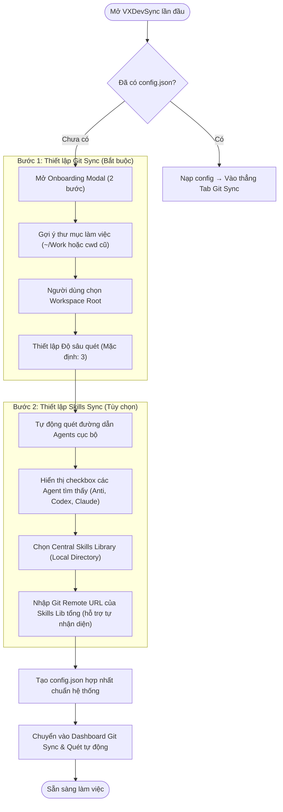
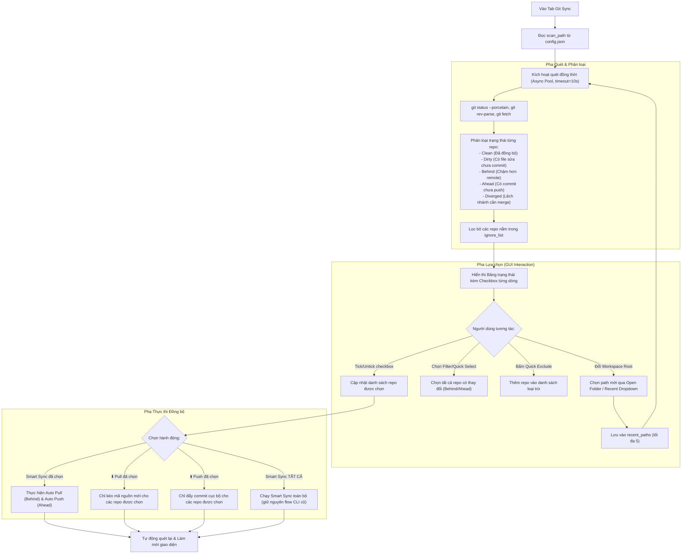
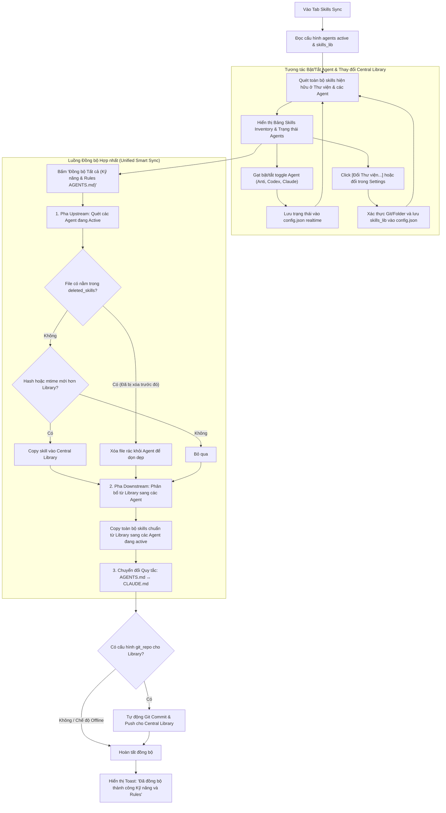
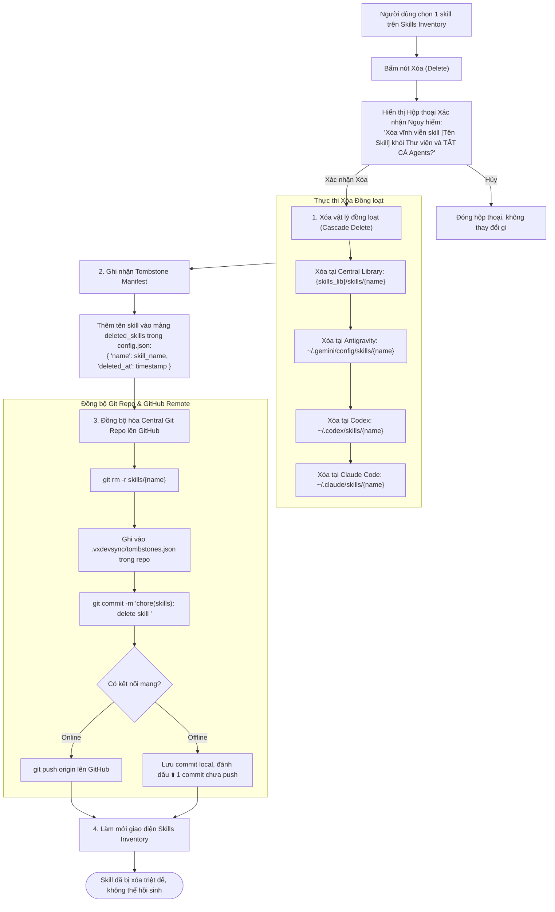
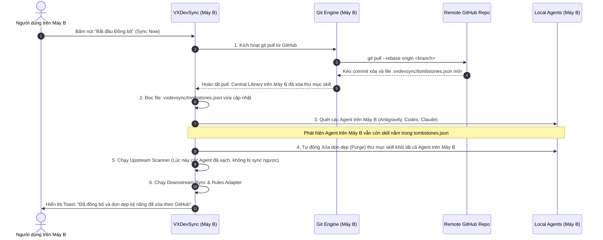

# 01. Quy trình Nghiệp vụ — VXDevSync
Version: 1.0.0 — Ngày cập nhật: 2026-10-15

Tài liệu này đặc tả các quy trình nghiệp vụ cốt lõi (Business Processes) của ứng dụng **VXDevSync**, bao gồm luồng chào đón & khởi tạo lần đầu (Onboarding), luồng đồng bộ Git đa dự án (Git Multi-Sync), luồng đồng bộ Kỹ năng AI (Skills Auto-Sync) và cơ chế xóa kỹ năng triệt để chống hồi sinh (Cascade Delete & Tombstone).

---

## 1. Quy trình Nghiệp vụ 1: Khởi tạo Lần đầu (Onboarding Wizard)

Quy trình kích hoạt khi ứng dụng phát hiện chưa có file cấu hình hệ thống `config.json` tại `Application Support/VXDevSync` (macOS) hoặc `%APPDATA%\VXDevSync` (Windows).

### Tiêu chuẩn Nghiệp vụ Bước Onboarding:
1. **Không làm gián đoạn người dùng:** Cung cấp nút "Sử dụng mặc định & Tiếp tục" (1-click) để dev có thể vào làm việc ngay trong 5 giây nếu không muốn tùy chỉnh sâu.
2. **Tự động dò tìm (Auto-detection):**
   - Tự động kiểm tra xem `~/.gemini/config` (Antigravity), `~/.codex` (Codex), `~/.claude` (Claude Code) có tồn tại trên máy hay không; nếu tồn tại thì tự động gạt bật toggle tương ứng.
3. **Mặc định đích đến:** Sau khi kết thúc Onboarding, ứng dụng luôn điều hướng người dùng vào tab **Git Sync** — đây là chế độ chính thường xuyên sử dụng nhất trong ngày.

---

## 2. Quy trình Nghiệp vụ 2: Quét & Đồng bộ Git Đa Dự án (Git Multi-Sync)

Quy trình giải quyết nghiệp vụ kiểm tra trạng thái nhiều kho mã nguồn (repositories) trong một Workspace và thực hiện các hành động đồng bộ hóa linh hoạt.

### Nguyên tắc An toàn trong Git Sync:
- **Nguyên tắc "Safe-Skip" với Dirty Repo:** Tuyệt đối không tự động pull hoặc push đè lên các repo đang có file sửa đổi dở dang (Dirty), trừ khi người dùng chủ động commit hoặc stash thủ công.
- **Bảo vệ nhánh Diverged:** Khi repo bị lệch cả 2 chiều (vừa có commit mới ở local, vừa có commit mới ở remote), hệ thống hiển thị cảnh báo màu đỏ và yêu cầu người dùng merge thủ công, không tự động force push làm mất code.

---

## 3. Quy trình Nghiệp vụ 3: Đồng bộ Kỹ năng AI Chéo (Skills Auto-Sync)

Quy trình đồng bộ các bộ quy tắc (`AGENTS.md`) và thư viện kỹ năng (`skills/`) giữa các Agent cục bộ và Central Skills Library.

---

## 4. Quy trình Nghiệp vụ 4: Xóa Kỹ năng Triệt để & Chống Hồi sinh (Cascade Delete & Tombstone)

Đây là quy trình nghiệp vụ quan trọng nhằm giải quyết dứt điểm **Bad Case của bản CLI** (khi xóa một skill ở 1 nơi thì khi sync lại bị các nơi khác copy ngược lại).

### A. Phân tích Bản chất Lỗi (Root Cause)
1. Trong mô hình Sync 2 chiều không có lịch sử trạng thái (state-less), một file không tồn tại ở thư mục A nhưng tồn tại ở thư mục B sẽ được hiểu là: *"Thư mục B vừa tạo ra một file mới cần được backup về A"*.
2. Do đó, việc xóa file thủ công ở một Agent hoặc ngay cả ở Central Library sẽ bị coi là *"nơi này chưa có file, cần được bù đắp từ các nguồn còn lại"*. Kỹ năng đã xóa lập tức được hồi sinh trên toàn bộ hệ thống!

### B. Giải pháp Quy trình: Cascade Delete + Tombstone Manifest

---

## 5. Cơ chế Đồng bộ Xóa Kỹ năng trên GitHub & Đa Thiết bị (Multi-Device Git Sync)

Đây là mắt xích cốt lõi bảo đảm khi người dùng sử dụng nhiều máy tính (ví dụ: PC tại văn phòng và Laptop cá nhân) cùng liên kết với một Central Skills Library trên GitHub:

### A. Tại máy thực hiện lệnh Xóa (Máy A)
1. **Xóa có kiểm soát qua Git (Tracked Deletion):**
   - Không chỉ xóa thư mục vật lý, engine chạy `git rm -r skills/<skill_name>`.
   - Cập nhật file `.vxdevsync/tombstones.json` nằm ngay trong thư mục gốc của Central Library repo. File này đóng vai trò là "Sổ đăng ký khai tử" dùng chung trên Git.
2. **Tạo Git Commit tường minh:**
   - Tạo commit với thông điệp: `chore(skills): delete skill '<skill_name>'`.
   - Lợi ích: Lịch sử Git rõ ràng, có thể tra cứu hoặc khôi phục lại kỹ năng qua `git revert` nếu người dùng lỡ xóa nhầm.
3. **Đẩy lên GitHub Remote (Push to GitHub):**
   - **Trường hợp Online:** Hệ thống tự động `git push origin <branch>` lên GitHub ngay lập tức. Trên GitHub, thư mục skill biến mất hoàn toàn khỏi branch chính, file `tombstones.json` được cập nhật.
   - **Trường hợp Offline:** Commit được lưu an toàn tại local repo. UI hiển thị badge: `Central Library: ⬆️ 1 commit chưa push`. Khi có mạng trở lại hoặc khi người dùng bấm nút "Đồng bộ", commit này sẽ tự động được đẩy lên GitHub.

### B. Tại máy tính thứ hai của người dùng (Máy B - Multi-Device Synchronization)
Khi người dùng mở VXDevSync trên Máy B (nơi các Agent trên Máy B vẫn còn giữ bản copy cũ của kỹ năng vừa bị xóa ở Máy A):

### C. Khôi phục Kỹ năng đã Xóa (Undo / Restore via Git History)
Do Central Library được bảo trợ bởi Git:
1. Nếu dev muốn phục hồi một kỹ năng đã xóa:
   - Vào Settings → tab Skills Sync → mục **"Quản lý Tombstones"**.
   - Bấm nút **"Phục hồi" (Restore)** bên cạnh tên kỹ năng.
2. Hệ thống tự động:
   - Xóa tên kỹ năng khỏi `.vxdevsync/tombstones.json`.
   - Tìm commit xóa gần nhất và chạy `git checkout <commit_sha>~1 -- skills/<skill_name>`.
   - Tạo commit mới: `chore(skills): restore skill '<skill_name>'` và push lên GitHub.
   - Tự động deploy kỹ năng trở lại các Agent đang active.

