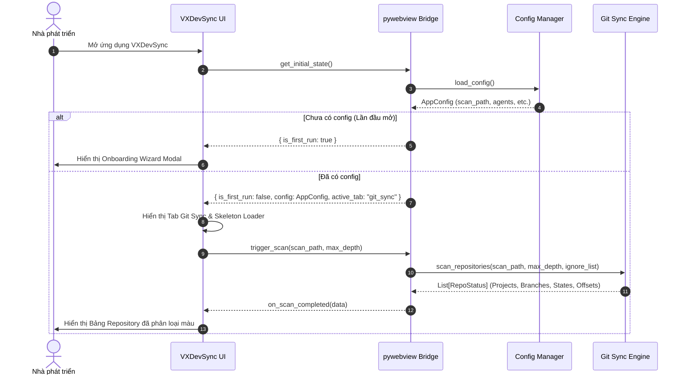
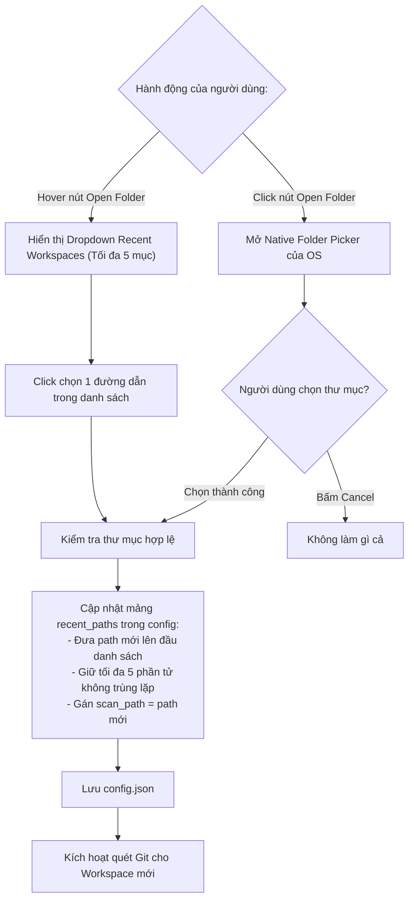
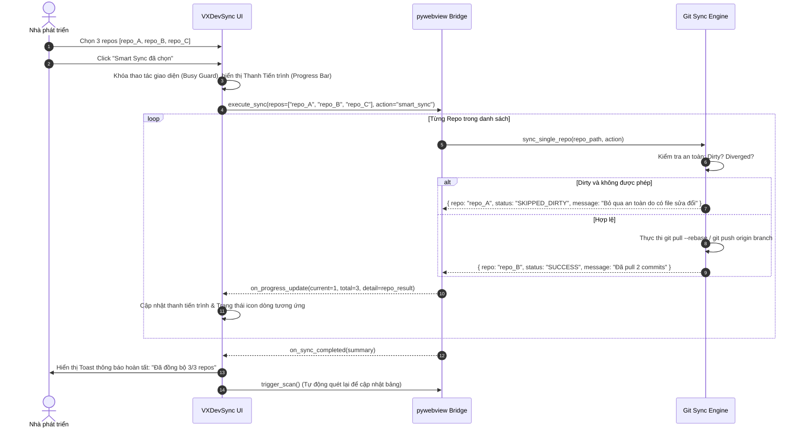
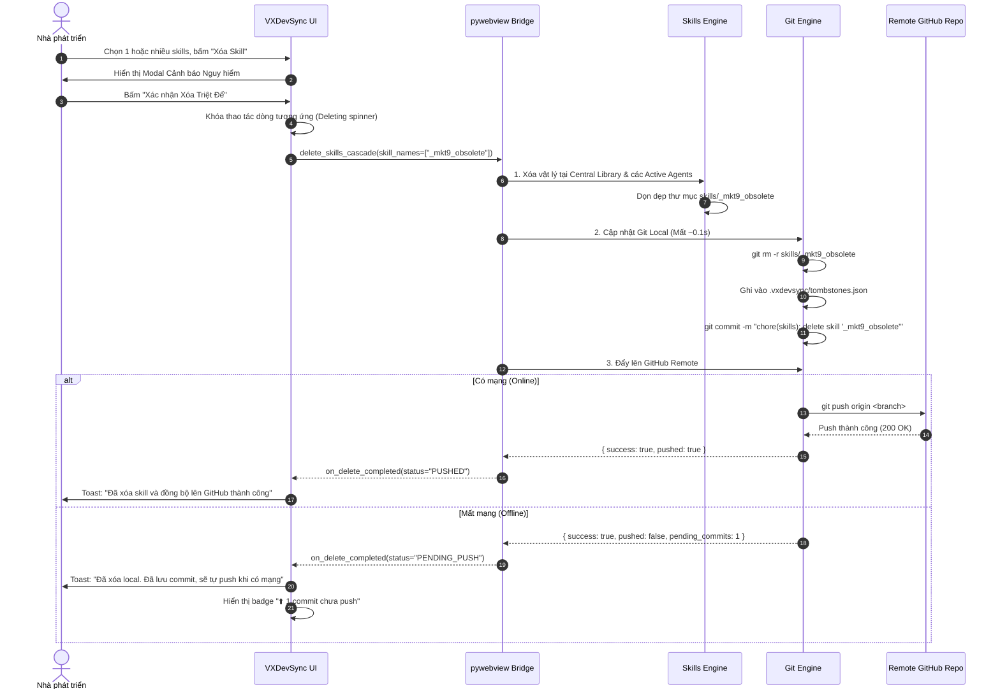
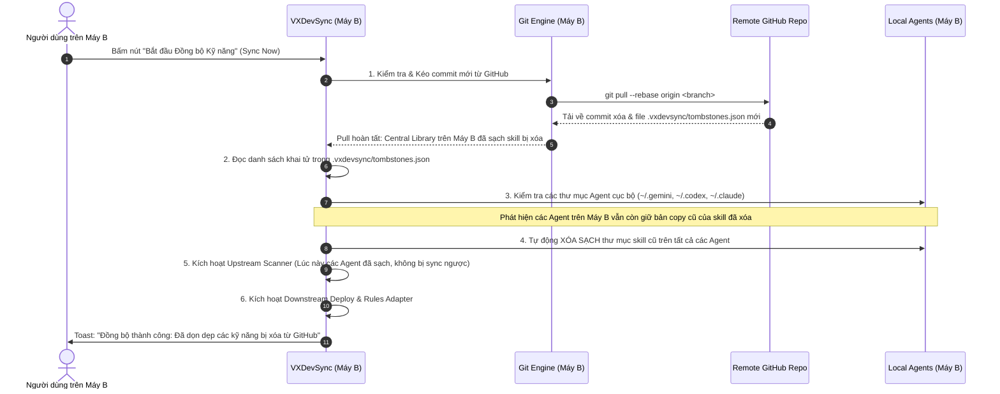

# 02. Chi tiết Luồng Tính năng — VXDevSync
Version: 1.0.0 — Ngày cập nhật: 2026-10-15

Tài liệu này đặc tả chi tiết các luồng chức năng (Feature Flows), các trạng thái dữ liệu (State Transitions) và chuỗi gọi hàm (Sequence Interactions) cho toàn bộ các tính năng của **VXDevSync**.

---

## 1. Luồng Tính năng 1: Khởi động, Khôi phục Workspace & Tự động Quét

Mục tiêu: Đảm bảo tính tiện lợi ngang ngửa CLI (mở app lên là sẵn sàng làm việc ngay, không cần thao tác chọn lại thư mục làm việc).

### Sequence Diagram: Khởi động ứng dụng

### Các trạng thái của Bảng Repository:
1. `IDLE`: Chưa quét hoặc đang chờ lệnh.
2. `SCANNING`: Hiển thị Skeleton loading + thanh thông báo *"Đang quét và kiểm tra nhánh remote..."*.
3. `READY`: Đã có dữ liệu, hiển thị danh sách kèm số lượng (ví dụ: *12 repositories tìm thấy*).
4. `ERROR`: Thư mục không tồn tại hoặc lỗi quyền đọc thư mục.

---

## 2. Luồng Tính năng 2: Chuyển đổi Workspace & Quản lý Recent Paths

Tuân thủ nghiêm ngặt mục "Mở file/thư mục và danh sách gần đây" trong [desktop_ui_standards.md](../../../_summary/standard_docs/desktop_ui_standards.md):
- Nút **Open Folder** đặt tại Titlebar bên cạnh tab navigation.
- Hover hoặc focus nút hiển thị dropdown tối đa **5 thư mục gần đây (Recent Workspaces)**, mới nhất đặt lên đầu.
- Click nút chính: Mở hộp thoại chọn thư mục gốc của hệ điều hành (Native Folder Picker).
- Click một mục trong dropdown: Chuyển ngay workspace hiện tại sang thư mục đó và kích hoạt quét lại.
- Chỉ lưu các lần mở thành công; không trùng lặp đường dẫn.

---

## 3. Luồng Tính năng 3: Quản lý Chọn Repo (Multi-selection) & Quick Exclude

Khắc phục hạn chế lớn nhất của CLI: Cho phép người dùng chủ động kiểm soát chính xác những repo nào sẽ được đồng bộ.

### A. Cơ chế Checkbox, Row-Click Selection & Header Controls
- **Click chọn cả dòng (Row-click Selection):** Người dùng có thể click vào bất kỳ vị trí nào trên hàng của repo để chọn hoặc bỏ chọn repo đó (không bắt buộc phải click chính xác vào ô checkbox nhỏ).
  - *Ngoại lệ an toàn:* Khi click trực tiếp vào các nút hành động (như icon `[️]` Exclude, `[⬇️]` Pull, `[⬆️]` Push) thì hệ thống chỉ thực thi hành động đó, không kích hoạt chọn/bỏ chọn dòng.
  - *Duyệt phím tắt:* Dùng phím mũi tên lên/xuống để di chuyển focus giữa các dòng, phím `Space` để toggle chọn/bỏ chọn dòng đang focus.
- **Header Checkbox:**
  - Trạng thái `Unchecked`: Không chọn repo nào.
  - Trạng thái `Indeterminate`: Đã chọn một số repo (nhưng chưa chọn tất cả).
  - Trạng thái `Checked`: Đã chọn toàn bộ repo hiển thị.
- **Nút "Chọn các repo có thay đổi" (Select Changed Only):** 1-click tự động tick chọn tất cả các repo có trạng thái `Behind` (cần pull) hoặc `Ahead` (cần push) hoặc `Dirty`, bỏ qua các repo đã `Clean` (Up-to-date).
- **Bộ lọc nhanh (Filter Tabs):** Tất cả (`All`), Cần Đồng bộ (`Needs Sync`), Đã Sạch (`Up-to-date`), Bị Lỗi/Lệch (`Conflicts`).

### B. Cơ chế Quick Exclude (Loại trừ Repo trên GUI)
Mỗi dòng trong bảng repository có nút biểu tượng **"Eye-Off / Exclude"** ở cột thao tác:
1. Khi click nút **Exclude**:
   - Hiển thị tooltip xác nhận: *"Bỏ qua repo `{repo_name}` khi quét?"*.
   - Nếu xác nhận: Thêm tên repo hoặc relative path vào `ignore_list` trong `config.json`.
   - Hàng tương ứng lập tức mờ đi hoặc biến mất khỏi danh sách hiển thị.
2. Để khôi phục: Người dùng mở Settings → tab Git Sync → Quản lý danh sách Ignore List → Bấm nút "Remove" bên cạnh tên repo đã loại trừ.

---

## 4. Luồng Tính năng 4: Thực thi Đồng bộ (Smart Sync / Push / Pull)

### Sequence Diagram: Đồng bộ các Repositories được chọn

---

## 5. Luồng Tính năng 5: Quản lý Kỹ năng AI (Skills Inventory & Agent Toggling)

### A. Quản lý Bật/Tắt Agent trực tiếp
Trên giao diện tab **Skills Sync**, hiển thị 3 Thẻ Card tương ứng với 3 AI Agents:
1. **Antigravity Card:** Biểu tượng AGY, đường dẫn `~/.gemini/config`, số kỹ năng hiện diện, nút Switch Toggle.
2. **Codex Card:** Biểu tượng Codex, đường dẫn `~/.codex`, số kỹ năng hiện diện, nút Switch Toggle.
3. **Claude Code Card:** Biểu tượng Claude, đường dẫn `~/.claude`, số kỹ năng hiện diện, nút Switch Toggle.

Khi người dùng gạt toggle:
- UI cập nhật trạng thái On/Off ngay lập tức.
- Bridge gọi `update_agent_status(agent_name, is_active)`.
- Config lưu giá trị `1` hoặc `0` vào trường `agents`.
- Bảng Skills Inventory bên dưới tự động tô xám hoặc ẩn cột của Agent bị tắt.

### B. Bảng Ma trận Skills Inventory
Hiển thị danh sách toàn bộ các kỹ năng tìm thấy trên hệ sinh thái:
- Cột **Skill Name:** Tên thư mục kỹ năng (ví dụ: `_spec0_system`, `_uxui1_styling`).
- Cột **Central Library:** Check xanh (tồn tại) hoặc Dấu gạch xám (thiếu).
- Cột **Antigravity:** Check xanh (đồng bộ), Chấm vàng (lệch hash/phiên bản), Gạch xám (chưa có).
- Cột **Codex:** Trạng thái tương tự.
- Cột **Claude Code:** Trạng thái tương tự.
- Cột **Hành động (Action):** Nút **Xóa (Delete)** màu đỏ.

### C. Cơ chế Thay đổi Thư mục Central Skills Library (`skills_lib`)
Người dùng có thể linh hoạt thay đổi thư mục Central Skills Library theo 2 cách thuận tiện:
1. **Thay đổi nhanh ngay tại Dashboard:** Click nút `[Đổi Thư viện...]` trên card Central Library ở đầu màn hình Skills Sync.
2. **Thay đổi trong Settings Modal:** Vào Settings → tab **Skills Sync** → mục `Thư mục Central Skills Library (skills_lib)` → Click `[Duyệt...]`.

**Quy trình xác thực & Cập nhật khi đổi thư mục:**
- Hệ thống mở Native Folder Picker để người dùng chọn thư mục mới.
- Sau khi chọn, hệ thống chạy hàm kiểm tra hợp lệ:
  * Kiểm tra thư mục có tồn tại và đọc được không.
  * Tự động phát hiện xem thư mục đã khởi tạo Git repo chưa (kiểm tra `.git/`). Nếu có Git, tự động lấy branch hiện tại và remote URL để điền vào trường `git_repo`.
  * Kiểm tra xem thư mục có thư mục con `skills/` chưa. Nếu chưa có, hỏi người dùng có muốn tự động tạo không.
- Lưu đường dẫn mới vào trường `skills_sync.skills_lib` trong `config.json`.
- Kích hoạt quét lại toàn bộ hệ thống để làm mới bảng ma trận Skills Inventory ngay lập tức.

### D. Tiến trình Đồng bộ Hợp nhất (Unified Smart Sync)
Thay vì chia tách thành 2 nút riêng biệt gây thừa thao tác ("Đồng bộ Kỹ năng" và "Đồng bộ Rules"), hệ thống gộp thành **1 nút bấm duy nhất**: `[ Đồng bộ Tất cả (Kỹ năng & Rules AGENTS.md) ]`.
Khi click nút này, tiến trình đồng bộ diễn ra tuần tự khép kín:
1. **Upstream Phase:** Quét các thay đổi từ các Agent đang active copy về Central Library (kiểm tra Tombstones để loại trừ kỹ năng đã xóa).
2. **Downstream Phase:** Phân bổ đồng loạt toàn bộ kỹ năng chuẩn từ Central Library sang các Agent đang active.
3. **Rules Adapter Phase:** Tự động đồng bộ và chuyển đổi định dạng quy tắc giữa `AGENTS.md` (chuẩn chung cho Antigravity, Codex) và `CLAUDE.md` (chuẩn Claude Code kèm header tương ứng).
4. **Git Sync Phase (nếu có cấu hình Git repo):** Tự động tạo commit và push các thay đổi mới lên GitHub Remote.

---

## 6. Luồng Tính năng 6: Xóa Skill An toàn & Cơ chế Tombstone Manifest

### A. Thời điểm Thực thi Commit & Push (Timing of Git Operations)
* **Quy tắc Vàng:** Mọi thao tác `git commit` và `git push` đối với việc xóa skill được thực hiện **NGAY TẠI THỜI ĐIỂM NGƯỜI DÙNG XÁC NHẬN XÓA**, tuyệt đối **KHÔNG trì hoãn đến khi đóng app**.
* **Lý do thiết kế:**
  1. *Tránh giật lag khi thoát:* Dev đóng app cần phản hồi tức thì (dưới 100ms), không thể để app bị đơ 2-5 giây chờ kết nối mạng `git push`.
  2. *Bảo vệ dữ liệu trước Force-Quit/Tắt máy:* Nếu OS tắt đột ngột, lệnh push bị ngắt giữa chừng sẽ làm hỏng Git index hoặc kẹt lock file.
  3. *Tính nhất quán tức thời:* Giúp các máy tính khác (Machine B) có thể pull được trạng thái xóa ngay mà không phụ thuộc vào việc Machine A có đóng app hay chưa.

### B. Sequence Diagram: Luồng Xóa Skill Tức Thì (Instant Delete on Machine A)

### C. Sequence Diagram: Luồng Đón Nhận & Dọn Dẹp trên Máy Tính Thứ Hai (Machine B)

### D. Xử lý Chi tiết các Trường hợp Biên (Edge Cases):
1. **Xóa hàng loạt (Bulk Delete):**
   - Khi dev tick chọn nhiều skills (ví dụ 3 skills) rồi bấm Xóa: Hệ thống thực hiện dọn dẹp đồng loạt và gom toàn bộ thay đổi vào **đúng 1 commit duy nhất** `chore(skills): delete 3 skills` và chỉ `git push` 1 lần duy nhất, tránh làm rác lịch sử commit.
2. **Khôi phục lại kỹ năng (Restore / Undo):**
   - Trong màn hình Settings → tab Skills Sync → mục **"Quản lý Tombstones"**: Hiển thị danh sách các skills đang bị khai tử.
   - Người dùng bấm nút "Khôi phục" (Restore). Hệ thống xóa tên khỏi `tombstones.json`, dùng `git checkout` lấy lại code từ commit cũ, tạo commit `chore(skills): restore skill` và push lên GitHub, sau đó phân bổ lại cho các Agent.
3. **File đang bị khóa bởi tiến trình OS / AI Agent:**
   - Nếu OS chặn không cho xóa thư mục skill (do Agent đang đọc file), hệ thống thông báo lỗi chi tiết, ghi nhận trạng thái xóa dở dang và thử lại khi đóng ứng dụng.

